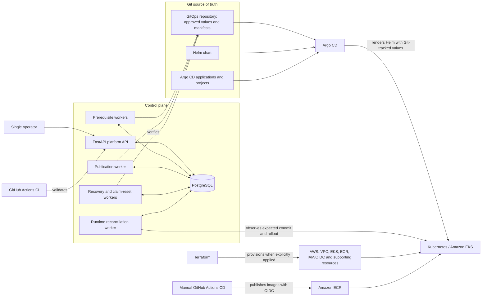
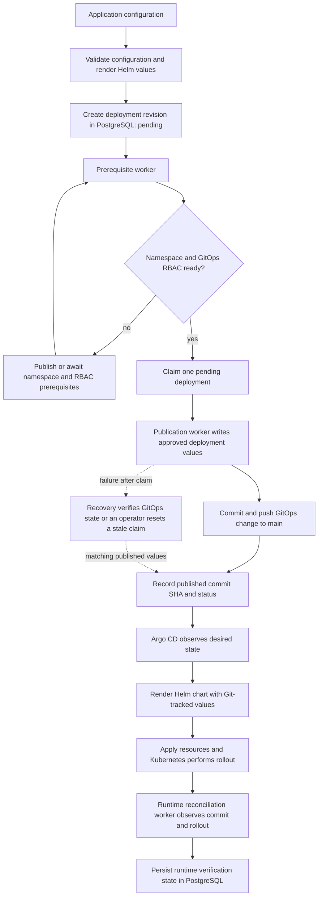

# AfterPush technical architecture

AfterPush is a single-operator platform engineering prototype for controlled
application deployments. This document is a technical reference for the
components and state transitions implemented in this repository. The
[README](../README.md) is the shorter project overview and local-demo entry
point.

## System architecture

The repository is the source of truth for the Helm chart, GitOps values, and
Argo CD definitions. Argo CD reads those sources and renders the Helm chart
with the selected values before applying the resulting Kubernetes resources.
Publication workers prepare Git state; they do not call Argo CD to deploy a
workload. Runtime reconciliation is a separate observer after publication.

## Control plane and deployment state

The FastAPI API creates and reads `Project`, `Application`, and `Deployment`
records through SQLAlchemy. PostgreSQL is the durable control-plane record for
an application’s deployment intent and outcome; it is not the desired-state
store consumed by Argo CD.

Each deployment records an environment, a monotonically increasing revision,
the copied image/port/replica specification, lifecycle status, publication
claim information, published Git commit SHA, runtime status, and timestamps.
Alembic manages the schema evolution. This separation lets the platform answer
two different questions:

- What deployment did the control plane request and publish?
- What did the runtime observer verify for that requested revision?

## Deployment lifecycle

The lifecycle has two deliberate boundaries. A prerequisite Git commit does
not prove that the namespace or RBAC is live, and a publication Git commit does
not prove that a Kubernetes rollout is healthy. Readiness gates and runtime
observation provide those checks separately.

## Workers and their responsibilities

### Prerequisite workers

Deployment prerequisites reconcile namespace bootstrap first and GitOps RBAC
second. They may publish the manifests needed for those prerequisites, then
wait for live Kubernetes readiness. They do not claim deployments, publish an
application workload, or change a deployment to published.

### Publication worker

The publication worker selects pending deployments, checks namespace and RBAC
readiness, and creates a publication claim so only one worker owns a given
operation. It rechecks readiness before persisting that claim, writes an
approved deployment values path in an isolated Git checkout, and records the
commit SHA only when the same claim still owns completion.

The publisher uses fresh `main` checkouts, rejects unapproved publication
paths, never force-pushes, and retries only non-fast-forward Git conflicts.
Its output is a Git commit; Kubernetes delivery remains Argo CD’s job.

### Recovery and claim-reset workers

If a worker fails after taking a claim, a recovery path examines expired
`publishing` deployments. It completes a deployment only when GitOps `main`
already contains values matching the claimed specification; recovery itself
does not make another Git push. A stale-claim reset is an operator-controlled
operation so an older worker cannot later publish with an invalid claim.

### Runtime reconciliation worker

Runtime reconciliation considers only the latest published revision for each
application and environment. It asks a Kubernetes/Argo observer to verify the
expected Git commit and workload rollout, then persists the result without
holding a database transaction during cluster observation. It does not publish
GitOps configuration.

The in-cluster CronJob is intentionally `suspend: true` by default. It must
not be enabled until its image, database Secret, ConfigMap, and application-
scoped read-only RBAC have been reviewed in the target cluster.

## Deployment revisions and promotion

New API deployments start in `dev` and receive the next revision for that
application/environment. Promotion copies the source deployment snapshot—not
mutable application settings—so the image, port, and replica count remain
reproducible.

A published, runtime-healthy `dev` deployment can create a `staging`
deployment. A healthy `staging` deployment can create a `prod` deployment,
which remains `awaiting_approval` until the explicit approval endpoint returns
it to the publication queue. Promotion therefore uses both a verified source
state and an explicit production approval boundary.

## GitOps publication and desired state

GitOps values and manifests are stored under `gitops/`; the shared Helm chart
is under `helm/afterpush/`; Argo CD root applications and ApplicationSets are
under `argocd/`. The active Argo CD sources in these definitions track `main`.

The chart templates application resources such as Deployment, Service,
Ingress, HPA, probes, NetworkPolicy, ServiceAccount, and monitoring-related
resources. Argo CD is the component that renders the chart with its configured
value files and reconciles the rendered resources. Helm itself is not a
long-running deployment controller.

## Terraform and AWS boundaries

Terraform has three independently validated configuration roots:

- `terraform/` contains the primary infrastructure configuration.
- `terraform/shared/` contains persistent/shared ECR and GitHub OIDC
  resources.
- `terraform/eks/` contains the EKS lifecycle and its supporting resources.

GitHub Actions initializes each root with `-backend=false` and validates it;
CI does not run Terraform apply or destroy. The separate state roots allow
shared delivery identity and image repositories to have a different lifecycle
from an EKS cluster.

The live EKS demo environment was shut down after the final ownership and
destroy-plan review. Terraform's EKS state is now empty; the shared state and
versioned S3 backend remain available for recovery. The PostgreSQL EBS volume
was removed only after a completed encrypted snapshot was verified. This
shutdown is live operational evidence, not evidence of a successful restore
or production deployment.

The image-delivery workflow is manually dispatched and assumes AWS access
through GitHub OIDC. It builds and pushes the platform API and runtime-worker
images to ECR. That workflow does not automatically apply Terraform or activate
the runtime reconciliation CronJob.

## Security decisions and current limitations

- The EKS GitOps values default the unauthenticated platform API ingress to an
  internal load-balancer scheme.
- Publication paths are allowlisted and validated before files are staged.
- Kubernetes security resources include scoped service accounts, NetworkPolicy
  templates, and dedicated observer/runtime RBAC manifests.
- Runtime verification reports an unverified or error outcome when it cannot
  prove the expected state; it does not convert uncertainty into success.
- Live AWS/EKS operations, Terraform apply/destroy, remote GitOps publication,
  and production database migration require explicit operator approval.

This is not a public multi-tenant SaaS or a claim of production operation.
Public API exposure would require an explicit authentication and authorization
design. The in-cluster runtime worker remains inactive by default, and no live
EKS rollout is represented as a completed local-demo result.

## Local demo versus live deployment

The [local demo](demo/local-journey.md) uses `afterpush_test`, temporary
schemas/directories, and an in-process FastAPI test client. It validates an
example configuration, creates a development deployment, renders temporary
values, and exercises promotion policy. The related publication test uses a
temporary bare Git repository.

Neither proof writes to GitHub, synchronizes Argo CD, calls an EKS cluster, or
proves a live workload health result. Those boundaries make the demo
repeatable and safe while keeping the live-delivery responsibilities visible.
The separate live EKS shutdown is documented above; no restore or rollout has
been verified.

For operational detail, see the [publication runbook](runbooks/deployment-publication.md),
[recovery runbook](runbooks/deployment-publication-recovery.md), and
[runtime reconciliation runbook](runbooks/runtime-reconciliation.md).
